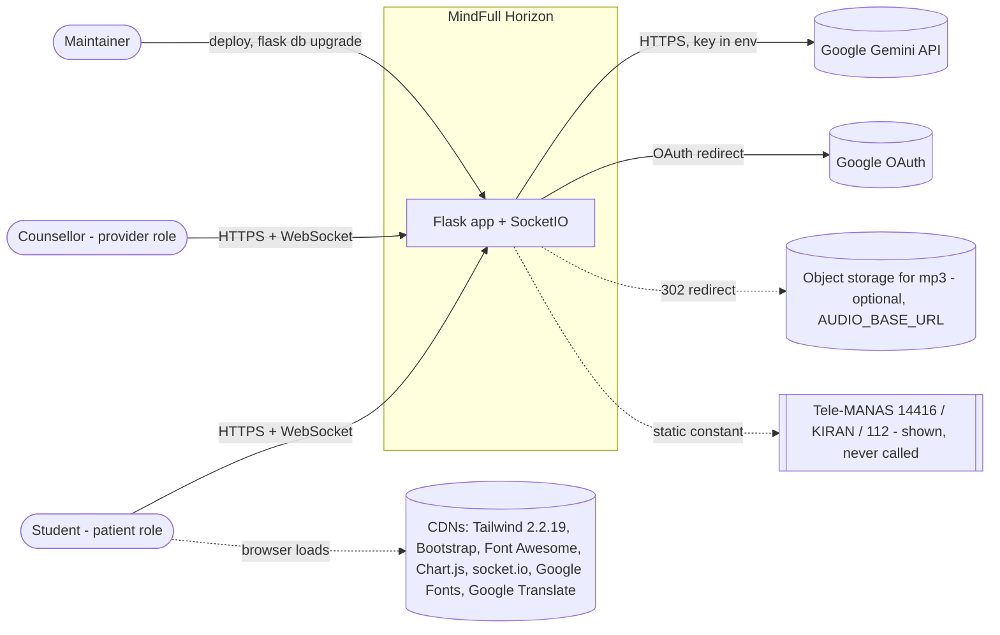
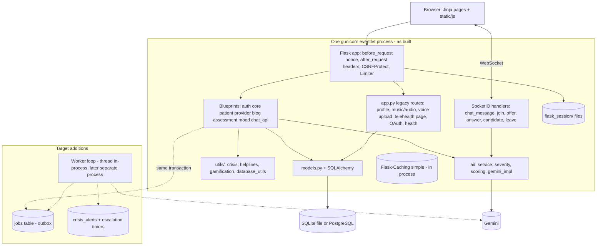
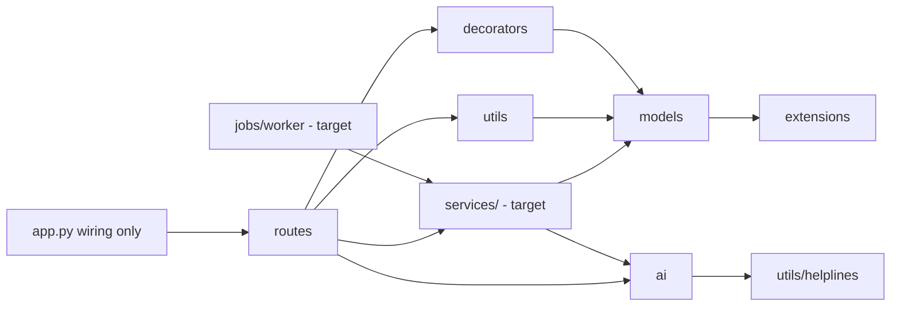
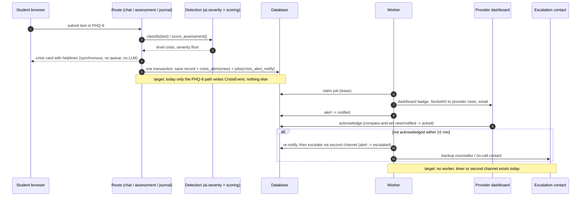

# Architecture

Status of this document: written 2026-11-24 from the files in the repo on that day. "As built" means found in code. "Target" means design only; the implementable detail is in [DESIGN.md](DESIGN.md). Other work was changing code while this was written, so re-check a claim against the file before relying on it. Open problems live in [STATUS.md](STATUS.md). `target-design.md` is the old aspirational microservice design and is not this architecture.

## 1. Purpose and constraints

MindFull Horizon is a Flask web app for college-student mental-health screening and support in India. Students check in (PHQ-9, GAD-7, mood, journal), use wellness tools and an AI companion, and book sessions. Campus counsellors (role `provider`) see a caseload, crisis alerts, appointments and wellness reports. It is a wellness and screening tool, not a medical device.

| Constraint | Consequence |
|---|---|
| Small team, no on-call | Prefer the database over new infrastructure; every extra moving part must earn its place |
| Render or Docker; one `gunicorn --worker-class eventlet --workers 1` process | SocketIO forces one worker. All in-process state (rate-limit counters, cache, sessions) is per process |
| SQLite in dev, PostgreSQL in prod | Every query, migration and queue algorithm must work on both |
| No Redis | No shared cache, no SocketIO message queue, no broker. A DB-backed job table fills the gap (target) |
| Health data of students, some under 18 | Authorisation is checked server-side on every route; patient text never goes to logs; crisis handling must not depend on the LLM or the queue |
| Gemini is a third-party processor | Treat model output as untrusted; deterministic code decides safety |

## 2. System context



## 3. Containers and components

As built there is one deployable: a single Python process. The worker and the second box are target.



Not present today: job queue, worker, audit log, request ids, readiness endpoint, a service layer, a shared cache, a CSS build.

## 4. Module map and dependency rules

| Path | Role | Notes |
|---|---|---|
| `app.py` (about 1,550 lines) | Config, extensions wiring, security headers, error handlers, SocketIO, Google OAuth, and routes not yet moved: `/profile`, `/chat`, `/api/message`, music and audio, voice upload and delete, telehealth page, `/health`, `/role_selection`, `/save_role` | Breaks the project's own rule "no new routes in app.py"; moving them is debt |
| `routes/` | One blueprint per area: `auth`, `core`, `patient` (about 1,080 lines), `provider`, `blog`, `assessment` (a stub), `mood`, `chat` | Registered from `routes/__init__.py` |
| `decorators.py` | `login_required`, `api_login_required`, `role_required`, `patient_required`, `provider_required`, `can_join_telehealth` | Reads the role from the session |
| `models.py` | All models, SQLite `foreign_keys=ON` listener, `get_institutional_summary` | Schema source of truth; one Alembic baseline `0001_baseline.py` |
| `extensions.py` | `db`, `migrate`, `flask_session`, `compress`, `csrf`, `limiter`; `init_extensions` | |
| `ai/` | `service.py` (chat with severity, insight generators, fixed crisis replies), `severity.py` (regex crisis classifier), `scoring.py` (PHQ-9/GAD-7), `gemini_impl.py` (SDK call), `interface.py` | No Flask or model imports (pure) |
| `utils/` | `crisis.py` (`record_crisis`), `helplines.py` (single helpline config), `gamification.py`, `database_utils.py` | `crisis` and `gamification` touch the DB |
| `ai_prompts/` | System prompt text | |
| `templates/`, `static/` | Jinja pages; `static/js` plus `static/js/inline_extracted`; `static/gen/packed.*` from Flask-Assets | |
| `migrations/`, `scripts/`, `tests/` | Alembic; `seed_demo`, dataset import, import scanner; pytest (about 130 tests, temp SQLite) | |

Dependency rules (arrows mean "may import"):



1. `models` imports only `extensions`. It never imports `routes`, `ai` or `app`.
2. `ai/` stays framework-free: no Flask, no SQLAlchemy. It may import `utils.helplines`. This keeps the safety code unit-testable with no app.
3. Routes validate input, authorise, call a service or the ORM, and shape the response. Business rules (crisis creation, state transitions, points, idempotency) do not live in routes. Today they do; the `services/` layer is target.
4. `app.py` may import everything but nothing imports `app.py` except tests. Routes use `current_app` and `extensions`.
5. Worker code is plain Python with no eventlet imports so it can later run as its own process.
6. No module-level mutable state that grows with traffic (see DESIGN section 6.10).

## 5. Request lifecycle (as built)

1. gunicorn eventlet worker receives the request; `Flask-Compress` wraps responses.
2. `before_request`: generates a CSP nonce in `g.csp_nonce`. Flask-Limiter applies the default limit (2000/day, 300/hour, 60/minute per IP, in memory) and any route limit. No request id.
3. `CSRFProtect` checks POST/PUT/DELETE tokens (the token comes from `<meta name="csrf-token">`; `/api/log-error` is exempt).
4. Flask loads the signed cookie session `mindfullhorizon_session`; `utils/session_stamp.py` drops it if the user's password, role or account changed since login.
5. Route decorators check `user_email` in session, then role. A browser request without a session is redirected to `/login`; an XHR (`X-Requested-With`) or `api_login_required` route gets JSON 401/403.
6. The handler queries SQLAlchemy and renders a template or returns JSON. Handlers call `db.session.commit()` themselves; there is no unit-of-work wrapper.
7. `after_request` adds `X-Content-Type-Options`, `X-Frame-Options: DENY`, `Referrer-Policy`, `Permissions-Policy`, `Content-Security-Policy-Report-Only` (not enforcing), and HSTS in production.
8. Errors: global handlers for CSRF, 400, 413 and 500 flash a message and redirect. They do this for JSON clients too, so an API caller gets a 302 to an HTML page on those errors (debt, see DESIGN section 7).

## 6. Data model

```mermaid
erDiagram
  USER ||--o{ ASSESSMENT : takes
  USER ||--o{ MOOD_LOG : logs
  USER ||--o{ JOURNAL_ENTRY : writes
  USER ||--o{ VOICE_LOG : records
  USER ||--o{ CRISIS_EVENT : "subject of"
  USER ||--o{ CRISIS_EVENT : "acknowledges"
  USER ||--o{ APPOINTMENT : "books as patient"
  USER ||--o{ APPOINTMENT : "serves as provider"
  USER ||--o{ CLINICAL_NOTE : "patient / provider"
  USER ||--o{ PRESCRIPTION : "patient / provider"
  USER ||--o| GAMIFICATION : has
  USER ||--o{ MEDICATION : takes
  MEDICATION ||--o{ MEDICATION_LOG : "taken as"
  USER ||--o{ GOAL : sets
  USER ||--o{ DIGITAL_DETOX_LOG : logs
  USER ||--o{ BREATHING_LOG : logs
  USER ||--o{ YOGA_LOG : logs
  USER ||--o{ MUSIC_LOG : logs
  USER ||--o{ RPM_DATA : "has (unused)"
  USER ||--o{ PROGRESS_RECOMMENDATION : gets
  USER ||--o{ NOTIFICATION : "sends / receives"
  USER ||--o{ BLOG_POST : authors
  BLOG_POST ||--o{ BLOG_LIKE : has
  BLOG_POST ||--o{ BLOG_COMMENT : has
  BLOG_COMMENT ||--o{ BLOG_COMMENT : replies
  BLOG_POST ||--o{ BLOG_INSIGHT : "most popular in"
  USER {
    int id PK
    string email UK
    string role "patient or provider (CHECK)"
    string institution "tenant key, free text"
    string google_id UK
    datetime last_assessment_at
  }
  ASSESSMENT {
    int id PK
    int user_id FK
    string assessment_type "PHQ-9 GAD-7 Daily Mood"
    int score "server-computed for PHQ/GAD"
    json responses
    text ai_insights
  }
  APPOINTMENT {
    int id PK
    int user_id FK
    int provider_id FK "nullable"
    date date
    string time "HH:MM text"
    string status "CHECK pending accepted rejected booked completed cancelled"
  }
  CRISIS_EVENT {
    int id PK
    int user_id FK
    string source "CHECK chat phq9 journal"
    int severity
    string reason "code, never user text"
    datetime acknowledged_at
    int acknowledged_by FK
  }
  MOOD_LOG {
    int id PK
    int user_id FK
    int mood_score "1-10"
  }
  JOURNAL_ENTRY {
    int id PK
    int user_id FK
    text content "plaintext"
  }
  VOICE_LOG {
    int id PK
    int user_id FK
    string filename
    text ai_analysis
  }
  MEDICATION_LOG {
    int id PK
    int medication_id FK
    datetime taken_at
  }
  GAMIFICATION {
    int id PK
    int user_id FK
    int points
    int streak
  }
```



Other tables, not drawn: `binaural_tracks` (dataset metadata), `institutional_analytics` (written by nothing; the dashboard computes aggregates live in `get_institutional_summary`). `BlogLike` has `unique(user_id, post_id)`. Foreign keys use `ON DELETE CASCADE` (SET NULL for optional provider and acknowledger), and SQLite gets `PRAGMA foreign_keys=ON` per connection.

Missing today (all target): `jobs`, `crisis_alerts`, `audit_log`, `idempotency_keys`, `points_ledger`; unique constraints on mood per day and medication per day; a slot-uniqueness index on appointments; encryption of journal, voice and assessment text; a version column on appointments. `CrisisEvent` is a record plus an acknowledgement, not yet an alert with states. Tenancy is the free-text `User.institution`, matched case-insensitively.

## 7. Crisis escalation

What exists: only the PHQ-9/GAD-7 path writes a `CrisisEvent` (`api_save_assessment` calls `record_crisis` for item 9 positive or a severe total). The provider dashboard lists unacknowledged events for its institution and `POST /provider/crisis/<id>/acknowledge` stamps `acknowledged_at/by` after a scope check. Chat (`/api/chat` and the SocketIO `chat_message`) and journal detect crisis wording and return fixed helpline text but do not write a `CrisisEvent`. There is no job, no notification, no timer and no escalation.

Target flow (the dashed notes mark what is not built):



## 8. AI call path and safety layers

```mermaid
flowchart TB
  in[User text] --> n[normalise: NFKC, lowercase, apostrophes, spelling variants]
  n --> f[classify: regex crisis / friend / soft / none]
  f -->|crisis| tmpl[Fixed crisis reply + helplines, action emergency_hotline]
  f --> call[Gemini call: system_instruction + user text, timeout 20 s, one fallback model]
  call -->|error or safety block| deg[Degrade: fixed reply by level, helplines if soft/friend/blocked]
  call --> parse[Regex-extract JSON, tolerant int, action allow-list, reply clamp 400 chars]
  parse --> fin[score = max of floor and model, crisis forces action and helplines]
  tmpl --> out[JSON to client]
  deg --> out
  fin --> out
  out --> ui[Client renders with textContent]
```

As built: the floor runs first and wins; `system_instruction` is used; `GEMINI_MODEL_NAME` is read; helplines come from `utils/helplines.py`; assessment crisis text never reaches the model; model-written resources are replaced by the helpline constant. Not built: input length caps and floor on the full text, structured output (`response_schema`), output sanitisation (links, HTML, phone numbers), redaction before the call, per-user budgets, a circuit breaker, the `google-genai` SDK (still legacy `google-generativeai`), schema validation on the non-chat generators (`generate_progress_recommendations` and others still use bare `json.loads` and return model JSON), and removal of the "Dr. Anya" persona in the journal prompt. The ordered target pipeline is DESIGN section 4.

## 9. Realtime and telehealth

SocketIO runs in the same process (`async_mode` chosen by the installed eventlet). `cors_allowed_origins` is same-origin unless `CORS_ORIGINS` is set.

| Event | Auth check | Room |
|---|---|---|
| `connect` | Session must hold `user_id`, otherwise the socket stays connected but joins nothing | joins `user_<id>` (nothing emits to it yet) |
| `chat_message` | `user_email` in session; 500 chars; calls `generate_chat_response` | reply to caller only |
| `join` | Room name must match `telehealth_room_<patient_id>`; `can_join_telehealth(patient_id)` allows the patient themself, or a provider of the same institution with a non-rejected appointment with that patient | joins the room |
| `offer`, `answer`, `candidate`, `leave` | Caller must be logged in and already in that room (`rooms()`) | relayed to the others in the room |

Gaps: the two HTTP telehealth pages disagree with the socket rule. `/provider/telehealth/<id>` accepts a provider with institution scope or any appointment, while the socket requires both; a provider can open the page and be refused the room. Signalling relays raw payloads without schema checks. No TURN server is configured, no session consent or recording policy exists, and `user_<id>` rooms are unused. A message queue is needed only when there is more than one SocketIO process or a separate worker must emit (target: Redis).

## 10. Security architecture

Authentication: email and password (Werkzeug hash, strength rules) or Google OAuth (Flask-Dance). Login needs the matching role. Providers can only be created with `PROVIDER_INVITE_CODE`; Google sign-up always yields `patient`; a Google email is linked to an existing account only if Google reports it verified. The login form distinguishes "no account" from "wrong password", which allows account enumeration (debt).

Session: Flask signed cookie `mindfullhorizon_session` (no server-side storage; see docs/SECURITY.md, Sessions), HttpOnly, SameSite Lax (Strict would drop it on the OAuth redirect), Secure in production, `SESSION_LIFETIME_HOURS` (24) lifetime refreshed on activity. Role, name and institution are copied into the session at login; a role or password change invalidates old cookies through the session stamp. `SECRET_KEY` is required in production (startup raises); in development a random key is generated per process.

Authorisation matrix (as built):

| Surface | Anonymous | Patient | Provider |
|---|---|---|---|
| `/`, `/login`, `/signup`, `/blog/` list and detail, `/health`, `/api/status`, `/music`, `/audio/*`, `/api/mood-music`, `/api/mood-audio`, `/api/assessment/next` | yes | yes | yes |
| `/patient/*` pages and APIs (`@patient_required`), `/api/upload-voice`, `/api/delete-journal-entry`, `/api/delete-voice-log` (own rows only) | 401 or redirect | yes | 403 or redirect |
| `/api/mood`, `/api/chat`, `/api/chats/<id>/messages` (id must equal own), `/api/ask`, `/api/chat/book-appointment` (patient only) | 401 | yes | yes (book: no) |
| `/provider/*` (`@role_required('provider')`) | redirect | 403 or redirect | yes, scoped to own institution or own appointments (`scoped_patient_or_404`) |
| Blog create, edit, delete, like, comment | like and comment 401, create redirect | yes | yes; edit and delete only by the post author (`_can_manage` also names an `admin` role that the schema does not allow) |
| `/api/message` | redirect | yes | yes |

Known authorisation gaps: `/api/message` lets any logged-in user create a notification for any `recipient_id` (no recipient check). `/api/ask` gives any logged-in user an open LLM relay (2,000-character cap, default rate limit only). `/api/mood-audio`, `/api/play-mood` and `/api/log-mood-selection` are public or lightly guarded. Tenancy rests on a free-text institution string. There is no audit trail of provider reads.

CSRF: `CSRFProtect` is global with a 7-day token lifetime; only `/api/log-error` is exempt. Headers: see section 5; CSP is Report-Only with `'unsafe-inline'` and a CDN allow-list, so it does not yet stop injected scripts. Rate limits: Flask-Limiter, key = client IP, storage in memory (lost on restart, per process, and a campus NAT shares one IP); `login` and `signup` 10 per minute on POST, voice upload 5 per hour, mood-selection log 30 per hour, error log 10 per minute. Secrets: environment only; `.env` is git-ignored but a real Gemini key was once in it (rotate, STATUS item 5).

PHI handling: stored in plaintext in the database (assessments, journals, voice logs, notes). Logs: patient text must not be logged; `CrisisEvent.reason` is a code. Some paths still log emails (`handle_chat_message`, login). Voice audio is analysed and discarded (only measurements are stored); profile pictures are not supported; nothing persistent is written to local disk. Target: field encryption for free text, retention rules, consent records, audit log (DESIGN section 9).

## 11. Deployment

| | Current | Target |
|---|---|---|
| Web | `Dockerfile` (Python 3.11-slim, non-root, gunicorn eventlet, 1 worker, port 5000); Render web service or local `python app.py` | Same, plus `/health` (liveness) and `/ready` |
| Database | SQLite `instance/mindful_horizon.db` (dev) or `DATABASE_URL` PostgreSQL; pool size 10, overflow 20, `pool_pre_ping` | Paid Postgres with backups; Alembic `upgrade` as a release step |
| Sessions | Signed cookies plus a stamp check | Same (stateless, any number of processes) |
| Jobs | none | `jobs` table, worker as a thread in the web process; at the first trigger a separate Render background worker |
| Redis | none | Paid Key Value with persistence only when a second SocketIO process, shared rate limits or fan-out is needed |
| Static | Tailwind 2.2.19 from CDN plus Bootstrap, Font Awesome, Chart.js, socket.io and Google Fonts from CDNs; Flask-Assets pack in `static/gen` | One built CSS file with hashed name, self-hosted fonts (DESIGN section 6) |
| Monitoring | Docker healthcheck on `/health`; log file `mindful_horizon.log` in the app directory plus console | JSON logs to stdout, uptime pinger on `/ready`, email alerts from the app |

`/health` runs `SELECT 1` and a config check but always answers 200 with `"status": "healthy"`, so it cannot fail a probe. Render's `postgres://` URLs may need rewriting to `postgresql://`; there is no code for it.

Environment variables:

| Name | Required | Purpose |
|---|---|---|
| `SECRET_KEY` | production | Session and CSRF signing |
| `FLASK_ENV` | yes | `production` turns on Secure cookies, HSTS, and skips `create_all` |
| `DATABASE_URL` | production | Defaults to the SQLite file |
| `GEMINI_API_KEY` | for AI | Without it every AI call falls back to canned text |
| `GEMINI_MODEL_NAME`, `GEMINI_TIMEOUT` | no | Default `gemini-flash-latest`, 20 s |
| `GOOGLE_OAUTH_CLIENT_ID`, `GOOGLE_OAUTH_CLIENT_SECRET` | for Google sign-in | |
| `PROVIDER_INVITE_CODE` | for provider signup | Unset means provider signup is closed |
| `CORS_ORIGINS` | no | Comma list; unset means same-origin SocketIO |
| `AUDIO_BASE_URL` | no | Bucket for mp3 redirects |
| `SKIP_CREATE_ALL`, `FLASK_DEBUG` | no | Migration bootstrap; debug server |

Target additions: `JOB_WORKER_ENABLED`, `ALERT_ESCALATION_MINUTES`, `GEMINI_DAILY_TOKEN_BUDGET`, `REDIS_URL` (later).

## 12. Scalability and limits: what breaks first

| Order | Limit | Symptom | Trigger | Fix |
|---|---|---|---|---|
| 1 | LLM calls block the single eventlet worker (the legacy SDK may not yield to eventlet, unverified; `asyncio.run` per chat call) | Chat and SocketIO stall while Gemini is slow | A few concurrent chats | Bulkhead, timeouts, run LLM work in a thread or job (DESIGN 4-5) |
| 2 | `import app` takes about 10 s and 249 MB RSS (nltk, scipy, librosa, textblob load eagerly) | Slow deploys, memory pressure on a 512 MB instance, slow health check at boot | Every start | Lazy imports (DESIGN 6.9) |
| 3 | SQLite single writer, no WAL or busy timeout set | "database is locked" under concurrent writes in dev | More than a few writers | Set WAL and `busy_timeout`; use Postgres in prod |
| 4 | Provider dashboard and `latest_by_user` load every row of the caseload; blog counts per post (N+1) | Dashboard latency grows with patients | Hundreds of patients per institution | Window queries, pagination (DESIGN 6.7) |
| 5 | In-process rate limits, `Cache('simple')`, session files | Limits reset on deploy, per-IP limits hit campus NAT, session loss on ephemeral disk | Any redeploy; more than one process | Redis or DB-backed stores |
| 6 | One process, one instance, no job queue | A deploy drops WebSockets and in-flight work; a crash loses an unsent alert | Every deploy | Outbox plus lease recovery (DESIGN 1) |
| 7 | Cross-region static CDNs and Tailwind 2.2.19 full CSS (about 2.8 MB uncompressed) on every page | Slow first paint on campus networks | Every page | CSS build, self-host (DESIGN 6.1) |

Throughput ceiling is not measured. Start from about tens of concurrent users on one small instance; load-test before any pilot.

## 13. As built versus target

| Area | As built | Target | DESIGN |
|---|---|---|---|
| Crisis alerts | `CrisisEvent` from PHQ-9 only; ack on dashboard | Alert state machine, notify job, escalation timer, all sources | 1, 3 |
| Job queue | none | `jobs` outbox plus worker | 1 |
| Idempotency | none (one duplicate check on medication per day, in code) | Unique constraints plus `Idempotency-Key` | 2 |
| State integrity | status CHECK on appointments, no transition table, plain `UPDATE`, `award_points` read-modify-write | Transition tables, compare-and-set, version column, atomic counters | 3 |
| LLM safety | Floor first, `system_instruction`, fixed crisis text, tolerant parse | Full 9-layer pipeline, budgets, breaker, injection test corpus | 4 |
| Resilience | 20 s timeout and one fallback model | Retries with jitter, breaker, bulkhead, `/ready`, request ids, metrics | 5 |
| Performance | CDN Tailwind, eager heavy imports, render-blocking scripts | Built CSS, lazy imports, caching, pagination | 6 |
| API conventions | Mixed JSON shapes (`success`, `ok`, `error`) and HTML redirects on errors | One error envelope, cursor pagination, `/api/v1` | 7 |
| UX | Gamified streaks and points exist; the crisis card exists on chat and assessment | Calm tokens, no loss framing, accessibility, Hindi | 8 |
| Audit | none | `audit_log` for provider reads | 9 |
| Migrations | One baseline plus a model-versus-migration test | Expand and contract discipline | 10 |
| Security | Report-Only CSP, memory limits, plaintext PHI | Enforcing CSP with nonces, field encryption, Redis limits | 10 |

## 14. Known technical debt

Linked to [STATUS.md](STATUS.md) (its Critical and High lists predate several fixes now in code: authentication on the listed endpoints, provider signup, SocketIO room checks and CORS, the `SECRET_KEY` fallback, `award_points` committing, journal and voice tables, server-side scoring, and a baseline migration. Re-audit STATUS.md before the next release.)

1. Plaintext PHI at rest (STATUS Critical 7). Impact: a database leak exposes all journals.
2. Crisis alerts incomplete: chat and journal write no event, no notification, no escalation (STATUS Critical 4).
3. CSP is Report-Only with `unsafe-inline` (STATUS High, headers).
4. `app.py` still holds legacy routes and the OAuth and socket code (STATUS Roadmap 4).
5. Three divergent implementations of severity bands: `ai/scoring.py`, `routes/provider.py::severity_band`, and the `get_severity_info` template helper in `app.py` (the last has no "moderately severe"). One module should own them.
6. `get_institutional_summary` scales Daily Mood by 2 (assumes 1-5), but mood is stored as 1-10, so wellness averages are inflated.
7. Journal and voice insights, `/api/ask` and the other generators bypass the validation pipeline; legacy Gemini SDK is end-of-life.
8. Tailwind 2.2.19 from a CDN, scripts that block rendering, many `innerHTML` uses across static JS (41 matches) with CSP not enforcing.
9. Mood is stored in two places (`MoodLog` and a `Daily Mood` assessment) written by two routes (`/api/mood` and `/patient/api/save-mood`) with different semantics.
10. Log file written into the app directory at DEBUG level; emails in some log lines.
11. `requirements.txt` refers to `docs/TRACKER.md`, which does not exist.
12. No CI, no load test, no restore drill; tests run SQLite only.
